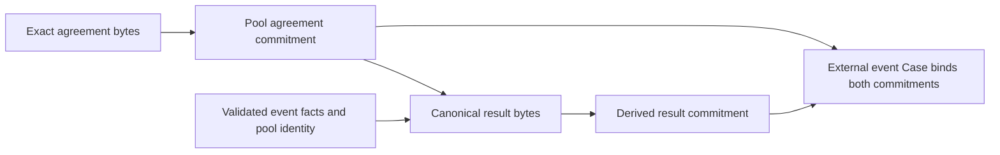

# Document commitments

A pool commits to the exact bytes of its immutable agreement. External event reviews also
commit to a canonical result generated from the proposed occurrence facts.
The protocol records those commitments; an application stores and presents the
readable documents.

For agreement bytes $A$ and canonical result bytes $R$,

$$
h_A = \operatorname{SHA256}(A),
\qquad
h_R = \operatorname{SHA256}(R).
$$

A matching hash establishes document identity. Establishing the truth of its
claims requires the event's evidence or source-verification process.

## Agreement boundary

Pool creation requires a nonzero agreement commitment and independently checks
the supplied event, accuracy curve, schedule and reviewed configuration terms.
It does not receive or parse the agreement document. Applications must check
that the agreement presented to participants describes those recorded terms,
evidence sources and review semantics accurately.

The pool's agreement commitment, schedule, algorithm and event definition are
immutable. Editing display metadata or an archive cannot change them. Revised
terms require a new pool. Identical document bytes can be used in independent
pools; the pool identities still distinguish their capital and review attempts.

## Canonical result

Manteon renders an external event result from typed occurrence facts instead of accepting
an arbitrary caller-supplied result hash. The result identifies the event type and
occurrence time, then binds them to the Manteon program, pool
and agreement commitment. It is hashed before the Tekmerion review opens.

The version 1 representation uses UTF-8 Markdown, LF line endings and a final
newline. Addresses use canonical base58, hashes use lowercase hexadecimal,
and UTC times use the four-digit calendar format from 1970 through 9999.
Integrations should use the shared result formatter to reproduce the exact
bytes; equivalent wording or formatting produces a different commitment.

Applying external event acceptance authenticates the selected Case's policy,
pool, author-specific identity, agreement commitment and derived result
commitment. Each proposal is checked against its own Case. Event stores only
the occurrence facts accepted by the first successfully applied final Yes;
pending or rejected proposals cannot overwrite them.

A price result records its confirmed occurrence time and verified price bounds
directly in Event. Its canonical document includes the complete fixed price
rule as well as those facts. A document hash can be derived, but this path
stores no separate result-hash field and creates no Tekmerion Case.

## Independent verification

1. Read authentic Pool/Event records from the intended network. For an external event,
   authenticate the relevant Tekmerion Case and its relationship to the pool.
2. Obtain the original document and hash its exact bytes. Trimming whitespace,
   changing newlines, normalizing Unicode or substituting a rendered PDF changes
   the input.
3. Compare the commitment, then compare the document's event, schedule, accuracy
   curve and configuration terms with the recorded facts. For a canonical
   result, reproduce the document from the relevant event facts.
4. Evaluate the evidence under the committed event rules, or the authenticated
   price confirmation under its fixed source rule.

A committed URL fixes the URL string; it does not freeze future page contents.
Evidence snapshots remain off-chain unless an application commits to them.
Publishing a document alone creates no pool or review and supplies no authorized
signature. Archive availability, issuer identity, token rights, network
provenance and program upgrades are separate dependencies.

Eligible owner withdrawals, horizon exits and claims require no archive or
agreement text. Their authorization comes from the protocol records.
