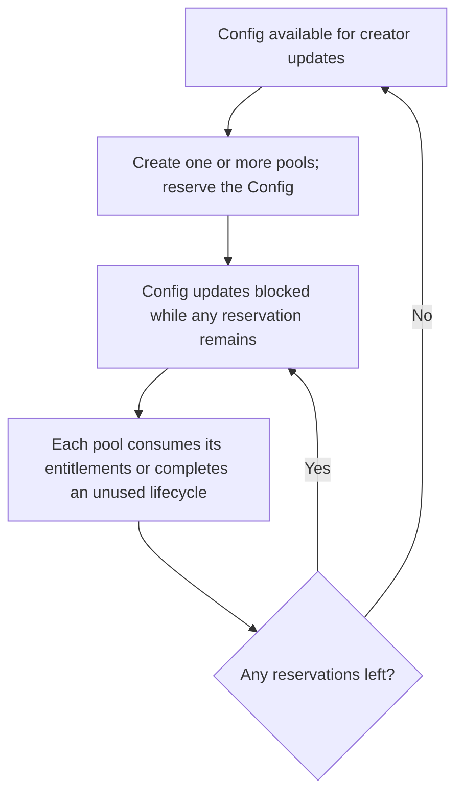
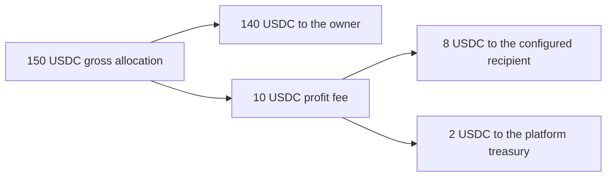

# Configuration and fees

Deployment governance, reusable pool settings and prediction custody have
separate authorities. A service manages the pool operations authorized to it;
owner entitlements and fixed accounting govern prediction capital.

## Deployment roles

The deployment has one GlobalConfig. Its one-time initialization requires the
program's authenticated upgrade authority and explicitly assigns a nonzero
admin, a nonzero fee authority and the platform's share of profit fees.
Initialization must precede Config creation and revocation of upgrade authority.
There are no default role addresses or default platform share.

| Role           | Rights                                                            |
| -------------- | ----------------------------------------------------------------- |
| Global admin   | Set fee authority and platform share; nominate a successor admin. |
| Pending admin  | Accept the nomination to become admin.                            |
| Fee authority  | Withdraw collected platform fees.                                 |
| Config creator | Update unused reusable settings; abandon unused Drafts.           |
| Config service | Create and activate pools; use the defined IPO service windows.   |
| Stake owner    | Sign their own deposits, eligible withdrawals, exits and claims.  |

Admin transfer requires nomination by the current admin and acceptance by the
successor. Nominating the current admin clears a pending nomination. Admin
transfer leaves the fee authority unchanged. The initializer retains only the
roles explicitly assigned to it.

Roles can be wallets or multisig signing authorities. A multisig program must
supply its authority's signature when calling Manteon; the multisig enforces
its own quorum and membership.

## Config lifecycle

Anyone may create a Config, with an independent payer for account storage. The
creator chooses the service, prediction collateral, fee recipient, bounded
profit fee and review-policy identity. Saving settings copies the GlobalConfig
platform share and checks that it matches the share the creator reviewed.

Creating a pool also checks a commitment to the reviewed Config terms. That
commitment covers the creator, service, collateral, fee recipient, fee rates
and policy, and excludes the usage count. Concurrent pools can therefore use
the same reviewed settings without invalidating that commitment.

Each created pool reserves the Config, including an unused Draft. A creator
can update the Config only when **all** reservations have been released. Pool
creation retains critical collateral, policy and fee facts, preserving the
meaning of historical claims after the Config is reused.

A pool releases its reservation exactly once:

- The last competitive claim consumes all frozen principal entitlements,
  including stakes with zero payouts.
- The last principal refund or horizon exit removes the remaining participating
  principal.
- An empty pool releases automatically when refunds become available or
  competitive settlement is finalized.
- An explicit completion action can abandon a Draft immediately when signed by
  its creator or service; anyone can abandon it at or after entry close.
  Anyone can also complete an empty Active pool at or after its horizon or a
  fully consumed Claimable/Refunding pool.

A Settling pool cannot complete, and completion cannot bypass unpaid
entitlements. Completion preserves historical accounts, prevents reactivation
and depends on entitlements rather than an empty token vault. Dust and donations
do not keep the reservation locked.

Shared Config settings require a nonzero review-policy identity. Only IPO
activation authenticates and retains that Tekmerion policy; price pools use
their fixed source rules without opening a review. Releasing a Manteon Config
reservation does not release Tekmerion's policy. The pinned review protocol
has no policy-release action, so acquired review terms remain immutable.

## Fees

The pool's profit fee ranges from 0 to 20%. The platform share ranges from 0 to
100% **of that fee**. Both are fixed for each pool. One basis point is 0.01%,
so the stored rates range from 0 to 2000 and 0 to 10,000 basis points respectively.

Let $p$ be Stake principal, $g$ its gross allocation, $r$ the profit-fee rate in
basis points and $s$ the platform share in basis points. Using integer token
atoms:

$$
\begin{aligned}
\pi &= \max(g-p,0),\\
f &= \left\lfloor \frac{\pi r}{10\,000} \right\rfloor,\\
f_{\mathrm{platform}} &= \left\lfloor \frac{fs}{10\,000} \right\rfloor,\\
f_{\mathrm{recipient}} &= f-f_{\mathrm{platform}},\\
n &= g-f.
\end{aligned}
$$

Here $\pi$ is positive profit, $f$ the total fee and $n$ the owner's net payment.
The platform share is included in the total fee. Losses, break-even allocations,
principal refunds, ordinary withdrawals and exits have no profit fee.
Transaction costs are separate.

For a 100 USDC Stake with a 150 USDC gross allocation, a 20% profit fee and a
20% platform share distribute the allocation as follows:

Claims use the pool's retained terms. A global-share update affects Configs
when they are created or edited while unused; it cannot rewrite an existing
pool's rates. The fee recipient must be an initialized collateral-token
account separate from the platform treasury. A claim needs the recipient
account only when its calculated share is positive.

## Platform treasury

Collected platform fees go to a shared treasury for their collateral mint.
Its identity and authority are fixed by the protocol. Config authors cannot
choose a replacement treasury or withdraw its funds.

The fee authority may withdraw a positive amount up to the treasury balance to
an initialized, unfrozen, distinct account of the same mint. This action has
no access to prediction pool vaults. Governance and service roles do not grant
principal custody rights.

See [the lifecycle diagrams](how-it-works.md#pool-states) and
[payout arithmetic](protocol.md#accuracy-and-payout-arithmetic) for when claim
rights arise and are consumed.
