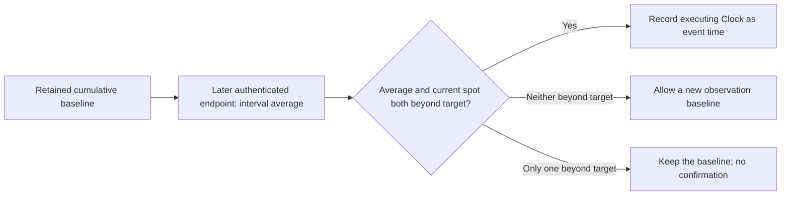

# Event rules

Each pool selects an immutable event definition and acceptance mechanism.
Company IPOs use evidence review through Tekmerion. Token price thresholds use
fixed on-chain sources. Both ultimately supply the UTC date used in
[settlement](protocol.md#accuracy-and-payout-arithmetic).

## Company IPO

The IPO rule identifies the token mint representing the company. The agreement
must define the issuer and evidence sources. The question is when the company
**actually completed its public IPO**. Announcements, estimates, token mint
creation and a token's first exchange trade do not establish that fact. If the
evidence establishes a date without a time, the agreed convention is midnight
UTC on that date. Evidence that cannot establish completion and its date calls
for an Unknown review answer.

A proposer supplies occurrence facts and funds a fresh Tekmerion review with a
separate USDC author bond. Manteon checks the event identity, a nonfuture time,
the supported calendar range and, for a competitive result, the allowed date
domain. It generates a canonical result commitment bound to the pool and its
agreement. It does not fetch websites or establish the external company facts.

### Review and acceptance

The pool retains its review policy when activated. Challengers may fund a
challenge under those locked terms:

- An underfunded challenge can close with **optimistic Yes** after its funding
  window. Auditors have not verified the report in this path.
- A fully funded challenge requires the appointed auditors to reach the
  threshold of matching signed answers: Yes, No or Unknown.
- Failure to reach agreement before the audit deadline closes as a technical
  failure and leaves the report unaccepted.

See [Tekmerion's process](../vendor/tekmerion/docs/how-it-works.md) for review
funding, voting, fees and withdrawals.

Manteon accepts only the pool's current, authenticated, finalized Yes, completed
optimistically or by audit. Applying that acceptance is a separate Manteon
transaction. A review result becoming final does not move prediction capital
or automatically freeze the pool.

An audited No, audited Unknown or technical failure permits a new attempt with
a fresh author bond. An accepted Yes ends that attempt sequence. Earlier
review claims remain available in Tekmerion, and retries preserve the time of
the first successfully funded proposal.

### Occurrence time and access windows

Three clocks have different meanings:

| Time                                    | Purpose                                                                 |
| --------------------------------------- | ----------------------------------------------------------------------- |
| Reported occurrence time                | The IPO fact under review and the UTC day used to score forecasts.      |
| First successfully funded proposal time | Anchors public proposal access across retries.                          |
| Review finalization time                | Anchors public access to applying acceptance and completing settlement. |

The service may propose as soon as the pool is Active. Other authors may
propose at the earlier of thirty days before the horizon and thirty days after
the first paid proposal. Before any proposal exists, the horizon-based opening
is the public path. A caller-supplied occurrence time cannot accelerate it.

The service may apply an accepted Yes and process/finalize settlement
immediately. Other callers may do so thirty days after that Case's
finalization. Every service window means exactly thirty UTC days, independently
of H30, H15 or H7. Owner claims require no service signature.

An accepted occurrence before entry close enables principal refunds. An
occurrence at or after entry close freezes the remaining capital for
competitive settlement. The horizon enables owner exits while the pool stays
Active, including during pending review; it does not impose an IPO occurrence
or review deadline.

## Token price threshold crossing

The price rule fixes a Raydium CPMM pool, tracked token, direction, positive USD
target, conversion source, minimum averaging interval, maximum monitoring gap
and minimum quote liquidity. CLMM and AMM v4 are unsupported. The sources and
parameters cannot be replaced after pool creation.

Prices represent USD per whole token with nine decimal places. An encoded
integer $x$ means $x/10^9$ dollars. Targets and calculations use integer
arithmetic, with lower and upper bounds where conversion or rounding creates
uncertainty.

### Supported USD conversion

| Tracked market and conversion                | Meaning of the interval price                                                                        |
| -------------------------------------------- | ---------------------------------------------------------------------------------------------------- |
| Token/USDC                                   | Average token price in canonical USDC, with USDC valued at exactly $1.                               |
| Token/SOL with Pyth SOL/USD                  | Average token/SOL price multiplied by the current verified SOL/USD confidence bounds.                |
| Token/SOL with a fixed Raydium SOL/USDC pool | Product of the two interval averages, using authenticated endpoints within 30 seconds of each other. |

The last path computes a product of averages; it does not reconstruct an
average of simultaneous USD products. Pyth conversion fixes the update
account, supported receiver and SOL/USD feed. Fully verified updates must be
positive, nonfuture and within the selected age and confidence limits.

### Baseline, average and spot

Activation must happen before opening and requires the current spot bounds to
be entirely opposite the target. For an upward crossing, the upper bound must
be below the target. For a downward crossing, the lower bound must be above it.
Activation saves an authenticated cumulative-price baseline.

A cumulative price records price integrated over time. If $C_0$ and $C_1$ are
its values at endpoints $t_0$ and $t_1$, the interval average follows

$$
\overline{p} = \frac{C_1-C_0}{t_1-t_0},
$$

with the source's fixed-point scale, token decimals and USD conversion applied.
The implementation handles cumulative-counter wrapping and rounds converted
bounds outward. It does not extend an old endpoint with today's spot price or
fill an unobserved interval.

The baseline belongs to Manteon, so Raydium observation-ring rewrites do not
erase it. The interval begins at that retained baseline, rather than at a
rolling chart window. A successful noncrossing observation advances it only
when neither the interval nor the current spot satisfies the target.

Let $q$ be the target and $[L,U]$ a verified price interval. A crossing requires

$$
\begin{aligned}
\text{upward:}&\quad L \geq q,\\
\text{downward:}&\quad U \leq q.
\end{aligned}
$$

**Both** the interval average and the current spot bounds must qualify. A bound
that straddles the target cannot confirm a crossing.

### Safeguards and expiry

| Requirement                    | Enforced boundary                                                                                          |
| ------------------------------ | ---------------------------------------------------------------------------------------------------------- |
| Minimum averaging interval     | 300–3600 seconds, selected by the pool.                                                                    |
| Maximum monitoring gap         | At least twice the minimum interval and at most 86,400 seconds.                                            |
| Quote liquidity                | At least $10,000 in fee-adjusted quote reserves; applies to both CPMM pools when using Raydium conversion. |
| Raydium endpoint freshness     | No more than 120 seconds old.                                                                              |
| Pyth update age                | Pool-selected limit of 1–120 seconds.                                                                      |
| Pyth confidence-to-price ratio | Pool-selected limit of 1–100 basis points.                                                                 |

These are validation bounds, not defaults. Source reads also authenticate
account owners, complete supported layouts, pool and mint identities,
observation identity, vaults and trading availability. Protocol, fund and
creator fees held in Raydium vaults are excluded from reserves. Source vaults
may use SPL Token or Token-2022.

Any wallet may submit observations, confirm a threshold or expire monitoring.
Confirmation must execute at or before the horizon and within the maximum gap
from the retained baseline. It records the executing on-chain Clock, clears
the baseline and atomically freezes principal or enables pre-close refunds.
Settlement processing is public immediately, with no Case, bond or auditors.

After the horizon, or once the retained baseline exceeds the maximum gap, any
wallet can expire monitoring. Expiry accepts no price-source accounts, clears
the baseline and enables principal refunds without creating an event time.
The expiry comparisons are strict: exactly at the horizon, confirmation and
owner exit can still be eligible; exactly at the maximum gap, an otherwise
valid observation or confirmation can still qualify.

Confirmation establishes verification time, not the first historical market
move. Average-plus-spot checks can reject brief spikes. Sustained manipulation,
USDC depegging, stale or unavailable sources and external program upgrades
remain limits of the rule. Controlled local tests verify its execution, not
live source availability or economic fair value.
