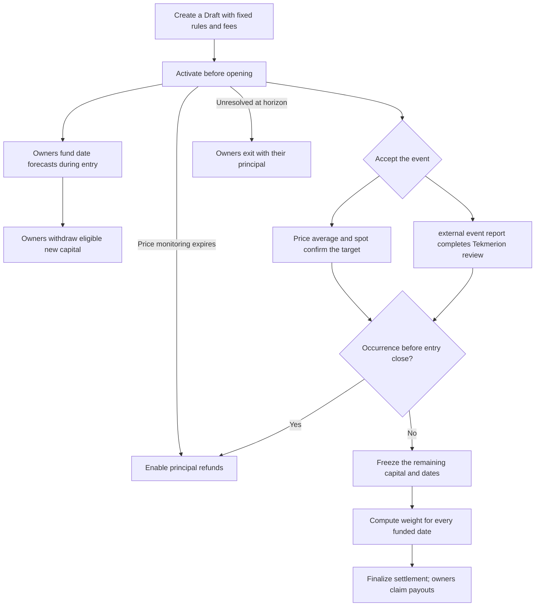
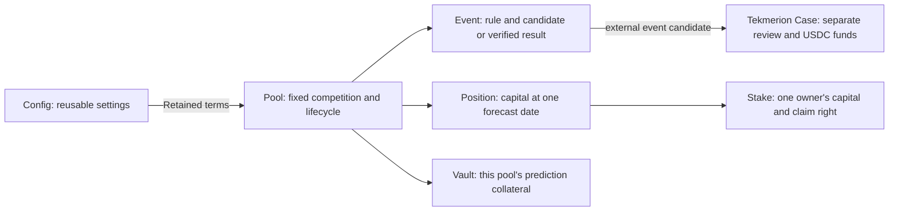
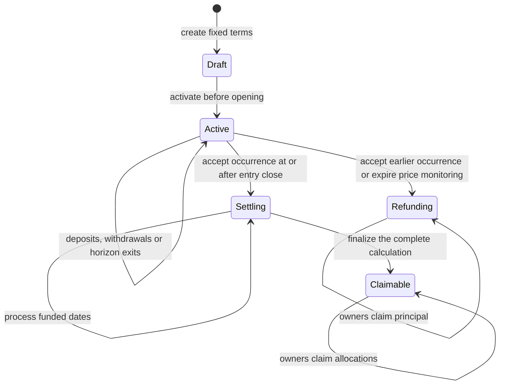
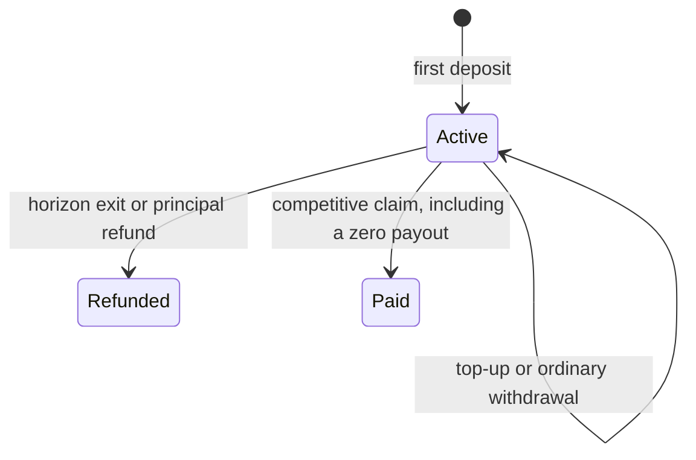

# How Manteon works

A service creates a pool with fixed rules and activates it before opening.
Owners fund date forecasts, the event is accepted through its selected
mechanism, and owners claim the resulting allocations or refunds. Each step
is an on-chain transaction; application jobs submit those same transactions.

## Operations



Ordinary withdrawals and horizon exits remove capital from the participating
pool at the same time as the token transfer. Event acceptance freezes only the
capital still participating. Once frozen, that basis stays fixed through all
competitive claims.

## How the records fit together

A Config holds reusable service, collateral, fee and review settings. A Pool
reserves that Config and fixes its own event, schedule and accuracy curve.
A Position groups the participating capital on one forecast date. A Stake
records one owner's capital at that date and whether its entitlement has been
consumed.



The prediction vault is governed by participation and payout rules. Review
bonds and challenge funds belong to Tekmerion's separate custody. Service,
configuration and governance roles do not gain discretionary access to
prediction principal.

## External event transaction sequence

```mermaid
sequenceDiagram
    participant Service
    participant Owner
    participant M as Manteon
    participant T as Tekmerion
    participant Review as Challengers and auditors
    Service->>M: Create and activate the pool before opening
    M->>T: Retain the pool's review policy
    Owner->>M: Fund a chosen UTC date while entry is open
    Service->>M: Propose external event occurrence facts
    M->>T: Open a review with the author's separate USDC bond
    Review->>T: Fund a challenge; vote if it reaches its target
    T->>T: Finalize acceptance, rejection, Unknown or timeout
    Service->>M: Apply the current accepted report
    M->>M: Freeze participating capital or enable early-event refunds
    Service->>M: Process funded dates and finalize settlement
    Owner->>M: Claim own allocation
    M->>Owner: Transfer net allocation and consume the entitlement
```

The proposal's occurrence time is the event fact being reviewed. Review
completion has its own time and governs public settlement access. A finalized
Yes becomes effective in Manteon only when an eligible caller applies it.
Until that transaction, an Active pool still follows its participation and
horizon-exit rules.

Rejection, an Unknown verdict or technical failure allows a new paid attempt.
Earlier review withdrawals remain available in Tekmerion. Other wallets gain
proposal and settlement access after the [defined service windows](events.md#external-event).

## Price transaction sequence

```mermaid
sequenceDiagram
    participant Service
    participant Wallet as Any wallet
    participant M as Manteon
    participant Sources as Fixed price sources
    Service->>M: Activate the pool before opening
    M->>Sources: Authenticate sources and opposite-side spot price
    M->>M: Save a cumulative-price baseline
    Wallet->>M: Submit a later observation
    M->>Sources: Read a fresh endpoint and current spot price
    M->>M: Advance the baseline only if neither has crossed
    Wallet->>M: Confirm the threshold
    M->>Sources: Verify that both the interval and spot qualify
    M->>M: Record confirmation time; freeze capital or enable refunds
    Wallet->>M: Process funded dates and finalize settlement
    Wallet->>M: Claim own allocation
```

An observation and a confirmation are separate actions. A qualifying
confirmation can use the baseline from activation or from an earlier accepted
observation. The [event rules](events.md#token-price-threshold-crossing) define
its averaging interval, freshness and uncertainty checks.

If the monitoring gap expires or confirmation misses the horizon, any wallet
can enable refunds without supplying price sources. This records no invented
occurrence date. Successful price confirmation makes settlement processing
public immediately.

## Pool states



State changes and transfers happen atomically within each instruction. A failed
instruction leaves its state and transfers unapplied. Separate instructions
may execute in separate transactions, and no deadline submits them automatically.

Completion releases a pool's reservation on its Config after its entitlements
are consumed. An unused Draft can also be abandoned. There is no general
service cancellation action for a funded Active pool. Historical records
remain available after completion; the pool cannot reopen. See
[configuration lifecycle](configuration.md#config-lifecycle).

## Stake states



A full ordinary withdrawal leaves the Stake Active with zero principal, so a
later eligible deposit can reopen its withdrawal allowance. An exit or claim
consumes the entitlement and prevents further deposits into that Stake or a
second payment. Competitive and refund claims preserve historical stake
principal; a horizon exit sets the remaining principal to zero.
