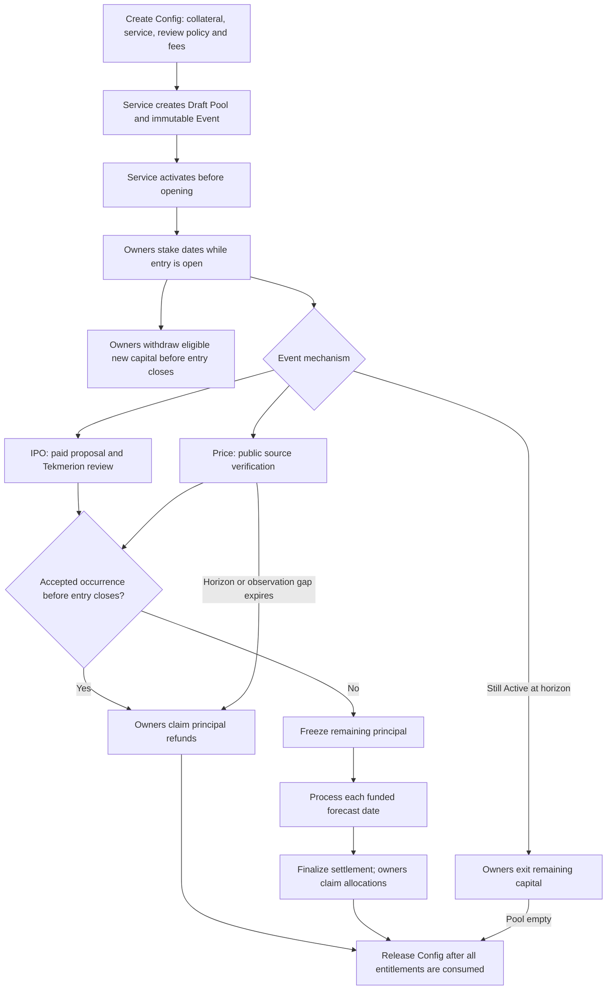
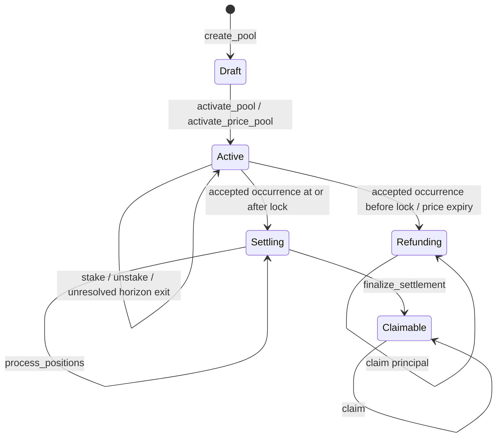
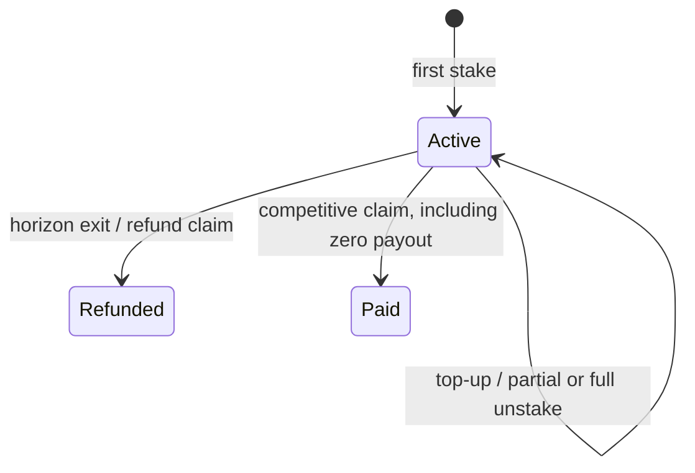

# How Manteon works

A service opens a pool with immutable rules. Owners commit forecasts and
capital, the event is accepted through its fixed mechanism, and remaining
capital is settled and claimed. Every diagram below describes program behavior;
an application's background jobs only submit the same authorized transactions.

## Operations



Withdrawals and exits reduce the participating book atomically with token
transfers. Once settlement freezes it, deposits, withdrawals and exits stop.
No deadline automatically sends a transaction or pays an owner.

## IPO transaction sequence

```mermaid
sequenceDiagram
    participant Service
    participant Owner
    participant M as Manteon
    participant T as Tekmerion
    participant Review as Challengers and auditors
    Service->>M: create_pool(config hash, agreement hash, schedule)
    M->>M: Reserve Config; create Pool, Event and vault
    Service->>M: activate_pool
    M->>T: acquire_policy via Manteon signer PDA
    T-->>M: Policy terms retained
    Owner->>M: stake(forecast_day, amount)
    M->>M: Transfer collateral; update Position and Stake
    Service->>M: propose_company_ipo(occurred_at)
    M->>M: Validate facts; render canonical result hash
    M->>T: create_case with separate author USDC bond
    Review->>T: Fund challenge; submit signed votes if funded
    T->>T: Finalize optimistic Yes, audited verdict or timeout
    Service->>M: begin_settlement with current finalized Yes Case
    M->>M: Authenticate both hashes; freeze or enable refunds
    Service->>M: process_positions (1 to 8 per transaction)
    Service->>M: finalize_settlement
    Owner->>M: claim
    M->>Owner: Net allocation
    M->>M: Transfer included fees; consume Stake
```

Other wallets gain proposal and settlement access after the
[defined service windows](events.md#company-ipo). A finalized No, Unknown or
technical failure permits a new paid attempt; the previous Case keeps its own
claims. Finalized Yes is applied to Manteon in a separate transaction.

## Price transaction sequence

```mermaid
sequenceDiagram
    participant Service
    participant Wallet as Any wallet
    participant M as Manteon
    participant Sources as Fixed Raydium and optional conversion accounts
    Service->>M: activate_price_pool with fixed source accounts
    M->>Sources: Authenticate source data and initial opposite-side spot
    M->>M: Save PriceMonitor baseline; mark Pool Active
    Wallet->>M: record_price_observation
    M->>Sources: Authenticate new endpoint and compute interval
    M->>M: Advance baseline only if neither price crosses
    Wallet->>M: finalize_price_threshold
    M->>Sources: Recheck interval and current spot against target
    M->>M: Record executing Clock; clear baseline; freeze or refund
    Wallet->>M: process_positions; finalize_settlement
    Wallet->>M: claim own Stake
```

These are distinct instructions; the sequence does not require them to fit in
one transaction. Each instruction is atomic. Invalid or stale sources leave
state unchanged. If monitoring expires, any wallet can call
`expire_price_observation` without source accounts and enable refunds, without
creating an occurrence date or a Tekmerion Case.

## Pool states



There is no Closed state. `config_released` records that a Pool has released its
configuration reservation and prevents reactivation or further participation.
The final competitive claim, final refund or exit emptying an Active Pool
releases it automatically. `complete_pool` also handles eligible unused Drafts
and empty Active Pools; see [configuration lifecycle](configuration.md#config-lifecycle).
Completing a Pool does not delete its historical accounts or unlock Tekmerion
policy terms.

## Stake states



A terminal Stake cannot be deposited into or paid again. Competitive and refund
claims retain historical Stake principal. Exit sets it to zero and consumes the
Stake. Full ordinary unstake also sets principal to zero, but leaves the Stake
Active so a later eligible deposit can open a fresh withdrawal window.
